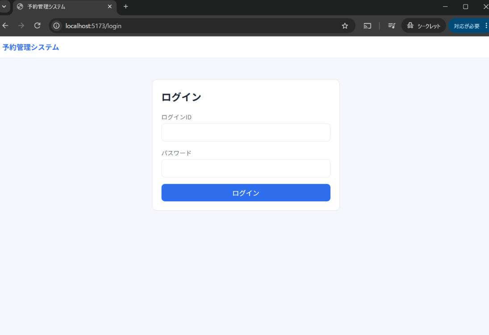
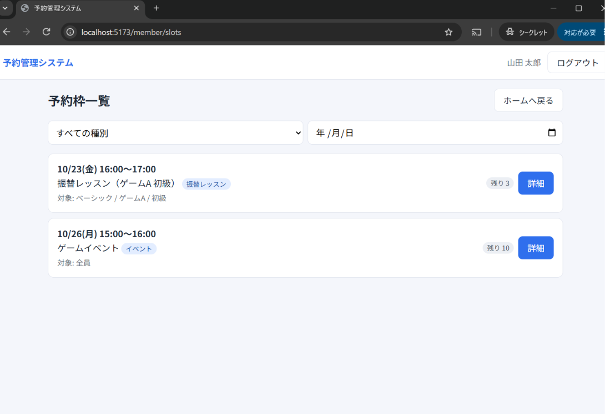
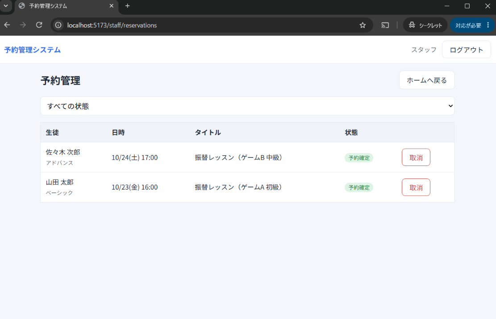
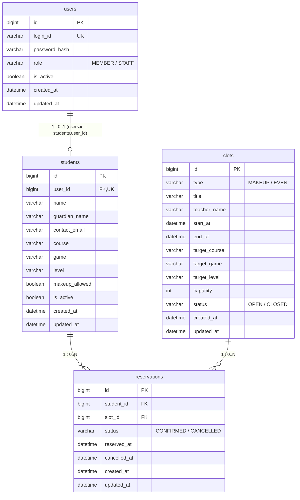
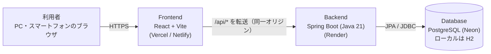

# 予約管理システム

> 振替レッスンとイベントの空き枠確認・予約を簡単にできるWebアプリ

スクールの **保護者（会員）** が、スマートフォンから自分の子どもに合う空き枠を確認して予約・取消でき、**スタッフ** が生徒情報・予約枠・全予約を一元管理できる予約管理アプリです。

## 開発の背景

<!-- TODO: あなた自身の言葉で書き直してください（評価観点「開発の背景」）。下は企画書から起こした下書きです -->
- 対象: スクールの運営スタッフと、受講生の保護者
- 課題: 振替レッスン・イベントの日程調整を個別の連絡で行っており、スタッフ・保護者の双方で手間がかかる。
- 解決: 空き枠の確認から予約・取消までをWeb上で完結させ、生徒情報や予約を一元管理する。

## アプリケーションのURL

- URL: https://reservation-app-kappa-eight.vercel.app
- テストアカウント
  | 種別 | ログインID | パスワード |
  |---|---|---|
  | スタッフ | `staff` | `staff1234` |
  | 会員 | `member1` | `pass1234` |

## デモ（画面イメージ）

<!-- TODO: 実際に起動して撮影したスクリーンショットを docs/images/ に置き、下を差し替えてください -->
| 画面 | 説明 |
|---|---|
|  | ログイン認証（会員／スタッフで遷移先が変わる） |
|  | 自分が対象の空き枠と残席を確認（会員） |
|  | 全予約・参加者の確認と取消（スタッフ） |

画面遷移図・画面設計書は [docs/images/screen-transition.png](docs/images/screen-transition.png) / [docs/images/screen-design.png](docs/images/screen-design.png) を参照してください。

## 主な機能

| 利用者 | 機能 |
|---|---|
| 共通 | ログイン／ログアウト（セッション認証）、未ログイン時は画面・APIとも利用不可 |
| 会員 | 対象の空き枠一覧（種別・日付で絞込）、枠詳細、予約、自分の予約一覧、予約取消、登録情報の確認 |
| スタッフ | 生徒の登録・検索・詳細・編集・退会、予約枠の登録・編集・受付停止、全予約・参加者の確認、予約取消 |

予約のルール: 対象コース／ゲーム／レベルに合う枠のみ・振替許可のある生徒のみ・満席／受付停止／開始済みの枠は不可・同じ枠の重複予約は不可・取消は開始前のみ。

## 設計上のポイント

- **残席は保存しない**: 残席を別の項目で持つと、予約や取消のたびに数がずれるかもしれないので、定員から予約数を引いて出すようにした。
- **権限はサーバー側で確認**: 画面でボタンを隠すだけだと、URLを直接開かれたら見えてしまうので、サーバー側でもチェックした。
- **履歴を残す**: 取消したときに消すと、あとで誰がいつ取り消したか分からなくなるので、状態だけ変えて残した。

### 苦労した点・つまずいたところ

- **取消のあとに一覧が更新されない**: 取消ボタンを押しても、一覧の表示が変わらなかった。取消が成功したあとに、一覧を読み込み直すようにして解決した。
- **取消済みの予約も一覧に出てくる**: 取り消した予約が、予約中の予約と同じように並んでしまった。状態（予約確定／取消済み）を表示して、見分けがつくようにした。
- **対象外の枠が見えてしまう**: コース・ゲーム・レベルが違う枠まで、全員に表示される。生徒の条件に合う枠だけ表示した。
<!-- TODO: 開発中に実際につまずいたこと・どう解決したかをあなた自身の言葉で書いてください（評価対象） -->

## 使用技術

| Category | Technology Stack |
|---|---|
| Frontend | JavaScript, React 18, Vite, React Router |
| Backend | Java 21, Spring Boot 3.3, Spring Data JPA, Spring Web |
| Authentication | Spring Security（セッション認証）, BCrypt |
| Database | H2（ローカル）, PostgreSQL（Neon） |
| Infrastructure | Render, Vercel |
| Build tool | Gradle, npm |
| Test | JUnit 5, MockMvc |
| etc. | Git, GitHub |

## ER図



`reservations` は `(student_id, slot_id)` の組合せを一意とします。ER図の元データ: [docs/images/er-diagram.png](docs/images/er-diagram.png)

## 構成図



## API一覧

| 機能 | メソッド | URL | 権限 |
|---|---|---|---|
| ログイン / ログアウト | POST | `/api/login` / `/api/logout` | 不要 / ログイン済み |
| ログイン利用者取得 | GET | `/api/me` | ログイン済み |
| 生徒 一覧・詳細・登録・更新(退会) | GET / GET / POST / PATCH | `/api/students`, `/api/students/{id}` | スタッフ |
| 予約枠 一覧・詳細 | GET | `/api/slots`, `/api/slots/{id}` | ログイン済み（会員は対象枠のみ） |
| 予約枠 登録・更新(受付停止) | POST / PATCH | `/api/slots`, `/api/slots/{id}` | スタッフ |
| 予約確定 | POST | `/api/reservations` | 会員 |
| 自分の予約 一覧・取消 | GET / POST | `/api/me/reservations`, `/api/me/reservations/{id}/cancel` | 会員 |
| 全予約・参加者 / 予約取消 | GET / POST | `/api/reservations`, `/api/reservations/{id}/cancel` | スタッフ |

詳細は [docs/design/](docs/design/) のAPI仕様書（xlsx）を参照してください。

## ローカル環境での起動方法

### 必要環境

- Java 21
- Node.js 20 以上
- Git
- Gradle 8.x（IDE（IntelliJ等）から起動する場合は不要）

### 1. リポジトリを取得

```bash
git clone <このリポジトリのURL>
cd reservation-app
```

### 2. バックエンド（Spring Boot）を起動

DBは **H2（ファイル保存）** を使うため、DBの事前準備は不要です。初回起動時にテーブルと動作確認用データが自動作成されます。

```bash
cd backend
gradle bootRun
# → http://localhost:8080 で起動します
```

> Gradle Wrapper を使う場合は、最初に一度 `gradle wrapper --gradle-version 8.10` を実行すると `./gradlew bootRun` が使えます。
> テストは `gradle test`（ログイン → 予約 → 重複不可 → 取消 → 権限チェックの流れを確認）。

### 3. フロントエンド（React）を起動（別のターミナル）

```bash
cd frontend
npm install
npm run dev
# → http://localhost:5173 を開きます（/api は自動でバックエンドへ転送）
```

### 4. ログインして動作確認

| 種別 | ログインID | パスワード | 備考 |
|---|---|---|---|
| スタッフ | `staff` | `staff1234` | 生徒・予約枠・予約の管理 |
| 会員 | `member1` | `pass1234` | ベーシック／ゲームA／初級・振替可 |
| 会員 | `member2` | `pass1234` | アドバンス／ゲームB／中級・振替可 |
| 会員 | `member3` | `pass1234` | 振替不可（振替枠が表示されないことを確認できる） |

データを初期状態に戻すには、バックエンドを止めて `backend/data/` を削除し、再起動します。

## 今後の改善案

- ログインIDやパスワードの変更機能、ごきょうだいの一括管理
- パスワード再発行

## ディレクトリ構成

```
reservation-app/
├── backend/    Spring Boot（controller / service / repository / domain / dto / config）
├── frontend/   React + Vite（pages / components / lib）
└── docs/       設計資料（要件定義・API仕様書・ER図・画面遷移図・画面設計書）
```
